# VelozMart MPS - relatorio de analise

Gerado a partir de `results\runs.csv`. 12840 execucoes; 21 cenarios; 12 estrategias; sementes por cenario: 30.

Configuracao de docas principal: `base_15`. IC = 95% (t de Student) entre sementes; comparacoes entre estrategias usam as mesmas sementes (mesmos pedidos).

## 1. Resposta rapida

**Algoritmo recomendado pelo criterio: EDF.**

- **normal_85:** nenhuma estrategia teve atrasos; o cenario nao discrimina as estrategias.
- **peak_105:** EDF reduz os atrasados de 4.7% (FIFO) para 0.0% e o P99 de 22.3 para 0.0 min.
  - menor % de atrasados: **edf** (0.0%); menor P99: **edf** (0.0 min); menos VIPs atrasados: **edf** (0.0%).
- **overload_125:** EDF reduz os atrasados de 43.7% (FIFO) para 41.9% e o P99 de 160.6 para 102.4 min.
  - menor % de atrasados: **two_queues** (15.4%); menor P99: **edf** (102.4 min); menos VIPs atrasados: **two_queues** (0.0%).

## 2. Pergunta III: metricas contra a ordenacao simples por tempo (FIFO)

### normal_85

| estrategia | % atrasados | % VIP atrasados | atraso medio (min) | P95 (min) | P99 (min) | pior (min) | pedidos/h |
|---|---|---|---|---|---|---|---|
| fifo | 0.00 ± 0.00 | 0.00 ± 0.00 | 0.00 ± 0.00 | 0.0 ± 0.0 | 0.0 ± 0.0 | 0.0 ± 0.0 | 415.0 ± 1.7 |
| edf | 0.00 ± 0.00 | 0.00 ± 0.00 | 0.00 ± 0.00 | 0.0 ± 0.0 | 0.0 ± 0.0 | 0.0 ± 0.0 | 415.0 ± 1.7 |
| composite | 0.00 ± 0.00 | 0.00 ± 0.00 | 0.00 ± 0.00 | 0.0 ± 0.0 | 0.0 ± 0.0 | 0.0 ± 0.0 | 415.0 ± 1.7 |
| two_queues | 0.00 ± 0.00 | 0.00 ± 0.00 | 0.00 ± 0.00 | 0.0 ± 0.0 | 0.0 ± 0.0 | 0.0 ± 0.0 | 415.0 ± 1.7 |
| bands_aging | 0.00 ± 0.00 | 0.00 ± 0.00 | 0.00 ± 0.00 | 0.0 ± 0.0 | 0.0 ± 0.0 | 0.0 ± 0.0 | 415.0 ± 1.7 |
| wspt | 0.00 ± 0.00 | 0.00 ± 0.00 | 0.00 ± 0.00 | 0.0 ± 0.0 | 0.0 ± 0.0 | 2.0 ± 2.3 | 415.0 ± 1.7 |
| vd_a0 | 0.00 ± 0.00 | 0.00 ± 0.00 | 0.00 ± 0.00 | 0.0 ± 0.0 | 0.0 ± 0.0 | 0.0 ± 0.0 | 415.0 ± 1.7 |
| vd_a0.5 | 0.00 ± 0.00 | 0.00 ± 0.00 | 0.00 ± 0.00 | 0.0 ± 0.0 | 0.0 ± 0.0 | 0.0 ± 0.0 | 415.0 ± 1.7 |
| vd_a1 | 0.00 ± 0.00 | 0.00 ± 0.00 | 0.00 ± 0.00 | 0.0 ± 0.0 | 0.0 ± 0.0 | 0.0 ± 0.0 | 415.0 ± 1.7 |
| vd_a2 | 0.00 ± 0.00 | 0.00 ± 0.00 | 0.00 ± 0.00 | 0.0 ± 0.0 | 0.0 ± 0.0 | 0.0 ± 0.0 | 415.0 ± 1.7 |
| vd_a3 | 0.00 ± 0.00 | 0.00 ± 0.00 | 0.00 ± 0.00 | 0.0 ± 0.0 | 0.0 ± 0.0 | 0.0 ± 0.0 | 415.0 ± 1.7 |
| vd_a5 | 0.00 ± 0.00 | 0.00 ± 0.00 | 0.00 ± 0.00 | 0.0 ± 0.0 | 0.0 ± 0.0 | 0.0 ± 0.0 | 415.0 ± 1.7 |

### peak_105

| estrategia | % atrasados | % VIP atrasados | atraso medio (min) | P95 (min) | P99 (min) | pior (min) | pedidos/h |
|---|---|---|---|---|---|---|---|
| fifo | 4.68 ± 0.69 | 14.33 ± 1.85 | 0.71 ± 0.16 | 2.3 ± 1.4 | 22.3 ± 3.8 | 48.1 ± 4.8 | 484.4 ± 3.1 |
| edf | 0.00 ± 0.00 | 0.00 ± 0.00 | 0.00 ± 0.00 | 0.0 ± 0.0 | 0.0 ± 0.0 | 0.0 ± 0.0 | 484.4 ± 3.1 |
| composite | 0.00 ± 0.00 | 0.00 ± 0.00 | 0.01 ± 0.01 | 0.0 ± 0.0 | 0.0 ± 0.0 | 109.2 ± 74.9 | 484.5 ± 3.1 |
| two_queues | 0.60 ± 0.22 | 0.00 ± 0.00 | 0.55 ± 0.27 | 0.0 ± 0.0 | 13.7 ± 11.5 | 125.2 ± 40.2 | 484.4 ± 3.2 |
| bands_aging | 0.01 ± 0.02 | 0.00 ± 0.00 | 0.00 ± 0.00 | 0.0 ± 0.0 | 0.0 ± 0.0 | 2.4 ± 3.1 | 484.5 ± 3.1 |
| wspt | 5.61 ± 0.41 | 0.00 ± 0.00 | 13.81 ± 1.27 | 40.1 ± 15.8 | 446.9 ± 25.4 | 627.4 ± 9.5 | 484.5 ± 3.2 |
| vd_a0 | 0.00 ± 0.00 | 0.00 ± 0.00 | 0.00 ± 0.00 | 0.0 ± 0.0 | 0.0 ± 0.0 | 0.0 ± 0.0 | 484.4 ± 3.1 |
| vd_a0.5 | 0.00 ± 0.00 | 0.00 ± 0.00 | 0.00 ± 0.00 | 0.0 ± 0.0 | 0.0 ± 0.0 | 0.0 ± 0.0 | 484.5 ± 3.1 |
| vd_a1 | 0.01 ± 0.01 | 0.00 ± 0.00 | 0.00 ± 0.00 | 0.0 ± 0.0 | 0.0 ± 0.0 | 1.9 ± 1.5 | 484.5 ± 3.1 |
| vd_a2 | 0.29 ± 0.14 | 0.00 ± 0.00 | 0.03 ± 0.02 | 0.0 ± 0.0 | 0.2 ± 0.4 | 23.7 ± 6.9 | 484.5 ± 3.1 |
| vd_a3 | 1.00 ± 0.30 | 0.00 ± 0.00 | 0.16 ± 0.06 | 0.0 ± 0.0 | 4.0 ± 2.5 | 60.1 ± 10.0 | 484.5 ± 3.1 |
| vd_a5 | 2.67 ± 0.48 | 0.00 ± 0.00 | 0.74 ± 0.17 | 0.1 ± 0.2 | 26.2 ± 6.0 | 135.5 ± 14.1 | 484.4 ± 3.2 |

### overload_125

| estrategia | % atrasados | % VIP atrasados | atraso medio (min) | P95 (min) | P99 (min) | pior (min) | pedidos/h |
|---|---|---|---|---|---|---|---|
| fifo | 43.67 ± 1.03 | 68.41 ± 0.98 | 26.70 ± 1.39 | 119.5 ± 3.9 | 160.6 ± 4.6 | 198.3 ± 5.7 | 493.7 ± 2.4 |
| edf | 41.91 ± 1.44 | 33.83 ± 1.87 | 18.87 ± 1.43 | 87.7 ± 4.8 | 102.4 ± 5.6 | 106.2 ± 5.8 | 493.8 ± 2.3 |
| composite | 40.53 ± 1.35 | 29.94 ± 1.81 | 18.94 ± 1.44 | 147.5 ± 16.0 | 386.8 ± 16.5 | 550.5 ± 27.1 | 493.9 ± 2.3 |
| two_queues | 15.37 ± 0.43 | 0.00 ± 0.00 | 42.77 ± 1.82 | 374.6 ± 14.8 | 616.3 ± 7.0 | 739.6 ± 9.2 | 493.9 ± 2.3 |
| bands_aging | 38.49 ± 1.40 | 19.54 ± 1.73 | 21.06 ± 1.41 | 98.9 ± 4.4 | 132.7 ± 4.8 | 263.1 ± 12.8 | 494.0 ± 2.3 |
| wspt | 19.27 ± 0.35 | 0.00 ± 0.00 | 66.66 ± 1.68 | 534.5 ± 7.3 | 704.4 ± 6.3 | 846.4 ± 11.2 | 493.8 ± 2.4 |
| vd_a0 | 41.91 ± 1.44 | 33.83 ± 1.87 | 18.87 ± 1.43 | 87.7 ± 4.8 | 102.4 ± 5.6 | 106.2 ± 5.8 | 493.8 ± 2.3 |
| vd_a0.5 | 42.18 ± 1.47 | 28.77 ± 1.93 | 19.09 ± 1.43 | 87.9 ± 4.8 | 104.2 ± 5.5 | 119.7 ± 5.7 | 493.9 ± 2.3 |
| vd_a1 | 42.42 ± 1.42 | 24.01 ± 1.92 | 19.57 ± 1.44 | 88.9 ± 4.8 | 109.1 ± 5.3 | 135.5 ± 6.2 | 493.8 ± 2.3 |
| vd_a2 | 42.41 ± 1.34 | 15.45 ± 1.80 | 21.20 ± 1.44 | 94.7 ± 4.6 | 123.1 ± 5.1 | 171.6 ± 7.7 | 493.8 ± 2.3 |
| vd_a3 | 41.79 ± 1.24 | 9.02 ± 1.52 | 23.23 ± 1.43 | 104.2 ± 4.3 | 139.9 ± 4.8 | 213.0 ± 9.2 | 493.8 ± 2.3 |
| vd_a5 | 39.76 ± 1.00 | 2.81 ± 0.95 | 27.59 ± 1.45 | 128.6 ± 4.1 | 179.7 ± 4.8 | 298.6 ± 13.2 | 493.9 ± 2.3 |

### black_friday

| estrategia | % atrasados | % VIP atrasados | atraso medio (min) | P95 (min) | P99 (min) | pior (min) | pedidos/h |
|---|---|---|---|---|---|---|---|
| fifo | 17.76 ± 0.62 | 44.83 ± 1.46 | 16.57 ± 0.84 | 150.4 ± 8.0 | 238.1 ± 8.6 | 288.8 ± 8.0 | 397.4 ± 2.8 |
| edf | 10.96 ± 0.20 | 18.64 ± 0.48 | 14.34 ± 0.83 | 161.2 ± 8.2 | 192.5 ± 8.9 | 199.1 ± 8.8 | 397.7 ± 2.8 |
| composite | 10.98 ± 0.20 | 18.54 ± 0.48 | 14.36 ± 0.84 | 29.2 ± 10.6 | 444.0 ± 14.1 | 661.8 ± 13.6 | 397.7 ± 2.8 |
| two_queues | 7.52 ± 0.34 | 0.01 ± 0.01 | 19.65 ± 0.96 | 137.4 ± 16.5 | 495.9 ± 11.8 | 715.0 ± 15.1 | 396.2 ± 3.0 |
| bands_aging | 10.97 ± 0.30 | 16.67 ± 0.50 | 14.57 ± 0.83 | 153.4 ± 8.1 | 211.5 ± 8.9 | 332.2 ± 19.1 | 397.7 ± 2.8 |
| wspt | 12.68 ± 0.33 | 0.01 ± 0.01 | 34.10 ± 1.15 | 306.7 ± 8.9 | 531.8 ± 8.8 | 781.3 ± 22.3 | 396.4 ± 2.9 |
| vd_a0 | 10.96 ± 0.20 | 18.64 ± 0.48 | 14.34 ± 0.83 | 161.2 ± 8.2 | 192.5 ± 8.9 | 199.1 ± 8.8 | 397.7 ± 2.8 |
| vd_a0.5 | 11.01 ± 0.20 | 17.95 ± 0.50 | 14.37 ± 0.83 | 160.8 ± 8.2 | 193.7 ± 8.9 | 212.2 ± 9.0 | 397.7 ± 2.8 |
| vd_a1 | 11.29 ± 0.26 | 17.26 ± 0.50 | 14.42 ± 0.83 | 159.3 ± 8.2 | 197.3 ± 8.8 | 227.7 ± 9.8 | 397.7 ± 2.8 |
| vd_a2 | 12.21 ± 0.42 | 15.87 ± 0.50 | 14.72 ± 0.83 | 154.9 ± 8.2 | 208.0 ± 8.8 | 262.0 ± 10.6 | 397.7 ± 2.9 |
| vd_a3 | 13.26 ± 0.46 | 14.49 ± 0.52 | 15.26 ± 0.84 | 151.5 ± 8.3 | 220.7 ± 8.9 | 298.4 ± 12.3 | 397.6 ± 2.9 |
| vd_a5 | 14.92 ± 0.49 | 12.06 ± 0.55 | 16.69 ± 0.84 | 150.3 ± 8.3 | 249.2 ± 8.5 | 372.0 ± 15.3 | 397.4 ± 2.9 |

### dock_outage

| estrategia | % atrasados | % VIP atrasados | atraso medio (min) | P95 (min) | P99 (min) | pior (min) | pedidos/h |
|---|---|---|---|---|---|---|---|
| fifo | 0.20 ± 0.10 | 0.97 ± 0.49 | 0.02 ± 0.01 | 0.0 ± 0.0 | 0.1 ± 0.3 | 13.5 ± 4.1 | 414.9 ± 1.9 |
| edf | 0.00 ± 0.00 | 0.00 ± 0.00 | 0.00 ± 0.00 | 0.0 ± 0.0 | 0.0 ± 0.0 | 0.0 ± 0.0 | 414.9 ± 1.9 |
| composite | 0.00 ± 0.00 | 0.00 ± 0.00 | 0.00 ± 0.00 | 0.0 ± 0.0 | 0.0 ± 0.0 | 0.0 ± 0.0 | 414.9 ± 1.9 |
| two_queues | 0.00 ± 0.00 | 0.00 ± 0.00 | 0.00 ± 0.00 | 0.0 ± 0.0 | 0.0 ± 0.0 | 2.5 ± 5.1 | 414.9 ± 1.9 |
| bands_aging | 0.00 ± 0.00 | 0.00 ± 0.00 | 0.00 ± 0.00 | 0.0 ± 0.0 | 0.0 ± 0.0 | 0.0 ± 0.0 | 414.9 ± 1.9 |
| wspt | 0.42 ± 0.11 | 0.00 ± 0.01 | 0.55 ± 0.22 | 0.0 ± 0.0 | 3.4 ± 6.9 | 252.2 ± 43.7 | 414.9 ± 1.9 |
| vd_a0 | 0.00 ± 0.00 | 0.00 ± 0.00 | 0.00 ± 0.00 | 0.0 ± 0.0 | 0.0 ± 0.0 | 0.0 ± 0.0 | 414.9 ± 1.9 |
| vd_a0.5 | 0.00 ± 0.00 | 0.00 ± 0.00 | 0.00 ± 0.00 | 0.0 ± 0.0 | 0.0 ± 0.0 | 0.0 ± 0.0 | 414.9 ± 1.9 |
| vd_a1 | 0.00 ± 0.00 | 0.00 ± 0.00 | 0.00 ± 0.00 | 0.0 ± 0.0 | 0.0 ± 0.0 | 0.0 ± 0.0 | 414.9 ± 1.9 |
| vd_a2 | 0.00 ± 0.01 | 0.00 ± 0.00 | 0.00 ± 0.00 | 0.0 ± 0.0 | 0.0 ± 0.0 | 0.3 ± 0.5 | 414.9 ± 1.9 |
| vd_a3 | 0.02 ± 0.02 | 0.00 ± 0.00 | 0.00 ± 0.00 | 0.0 ± 0.0 | 0.0 ± 0.0 | 6.5 ± 4.4 | 414.9 ± 1.9 |
| vd_a5 | 0.10 ± 0.06 | 0.00 ± 0.00 | 0.02 ± 0.02 | 0.0 ± 0.0 | 0.0 ± 0.0 | 36.9 ± 14.5 | 414.9 ± 1.9 |

## 3. Criterio de decisao: EDF x prazo virtual

Criterio (secao 5.3): o prazo virtual so substitui o EDF se, em **todos** os cenarios decisivos (peak_105, overload_125, black_friday), reduzir os VIPs atrasados em pelo menos 50% (partindo de pelo menos 1.0% de VIP atrasado no EDF) sem piorar a % de atrasados em mais de 1.0 pp nem o P99 em mais de 20%; diferencas dentro do IC 95% pareado por semente contam como empate; nos cenarios de guarda (normal_85) nao pode regredir.

| estrategia | cenario | papel | VIP EDF % | VIP estrat. % | reducao VIP | delta % atrasados (pp) | IC | delta P99 (%) | passa |
|---|---|---|---|---|---|---|---|---|---|
| vd_a1 | peak_105 | decisivo | 0.00 | 0.00 |  | 0.01 | 0.01 | 0.00 | nao |
| vd_a1 | overload_125 | decisivo | 33.83 | 24.01 | 29.02 | 0.51 | 0.35 | 6.53 | nao |
| vd_a1 | black_friday | decisivo | 18.64 | 17.26 | 7.41 | 0.33 | 0.19 | 2.48 | nao |
| vd_a1 | normal_85 | guarda | 0.00 | 0.00 |  | 0.00 | 0.00 | 0.00 | sim |
| vd_a2 | peak_105 | decisivo | 0.00 | 0.00 |  | 0.29 | 0.14 | 0.00 | nao |
| vd_a2 | overload_125 | decisivo | 33.83 | 15.45 | 54.33 | 0.50 | 0.49 | 20.21 | nao |
| vd_a2 | black_friday | decisivo | 18.64 | 15.87 | 14.88 | 1.25 | 0.38 | 8.05 | nao |
| vd_a2 | normal_85 | guarda | 0.00 | 0.00 |  | 0.00 | 0.00 | 0.00 | sim |
| vd_a3 | peak_105 | decisivo | 0.00 | 0.00 |  | 1.00 | 0.30 | 401.14 | nao |
| vd_a3 | overload_125 | decisivo | 33.83 | 9.02 | 73.34 | -0.12 | 0.54 | 36.64 | nao |
| vd_a3 | black_friday | decisivo | 18.64 | 14.49 | 22.25 | 2.30 | 0.44 | 14.65 | nao |
| vd_a3 | normal_85 | guarda | 0.00 | 0.00 |  | 0.00 | 0.00 | 0.00 | sim |

**Veredito:** **EDF**: nenhum prazo virtual testado atende ao criterio (ou os resultados empatam, e o empate vai para o EDF pela simplicidade).

## 4. Graficos

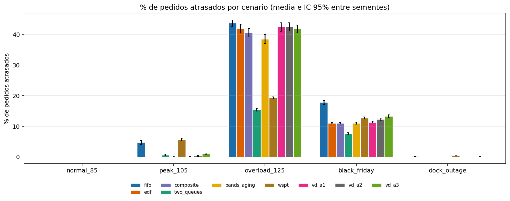

_% de pedidos atrasados por cenario e estrategia._

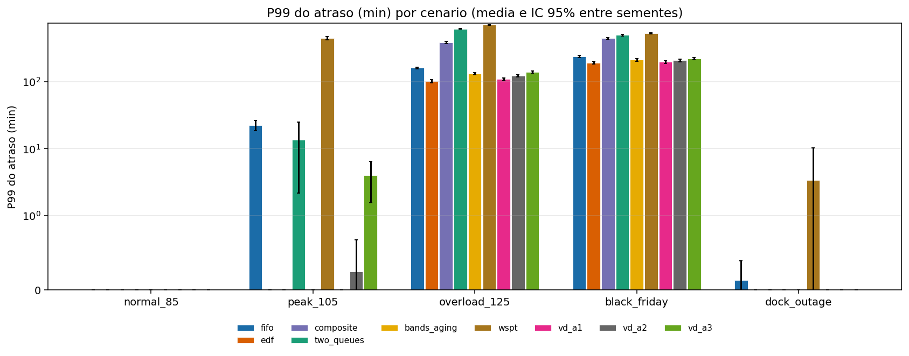

_P99 do atraso (min) por cenario e estrategia._

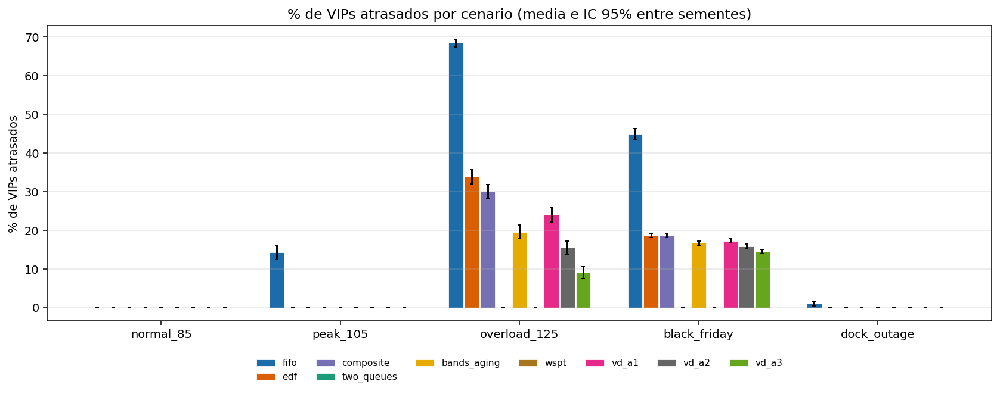

_% de VIPs atrasados por cenario e estrategia._

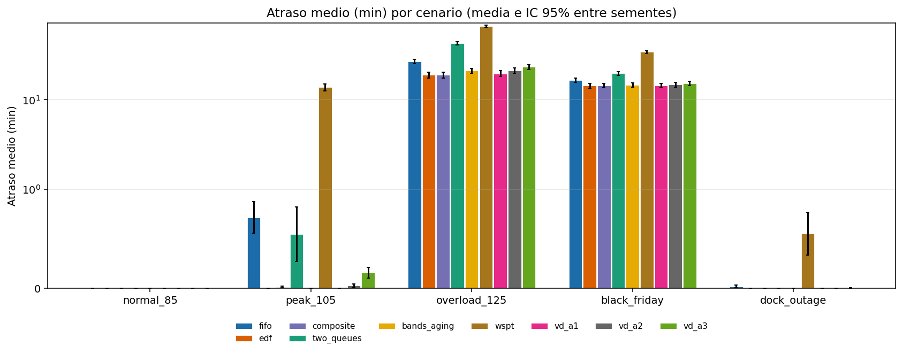

_Atraso medio (min) por cenario e estrategia._

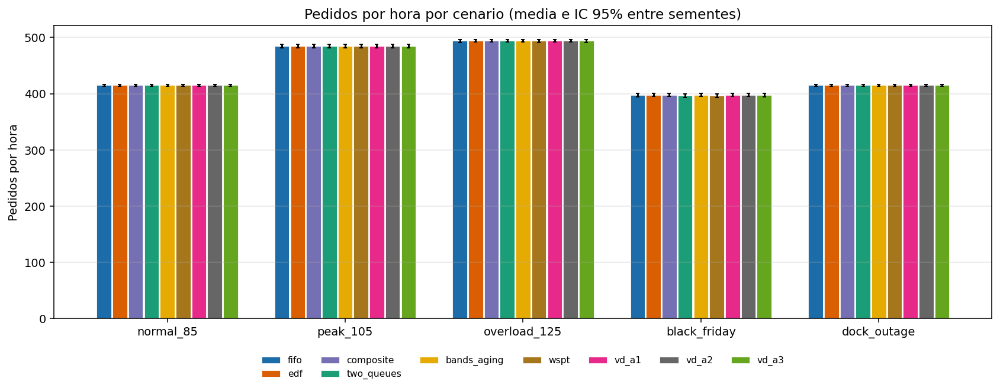

_Pedidos por hora por cenario e estrategia._

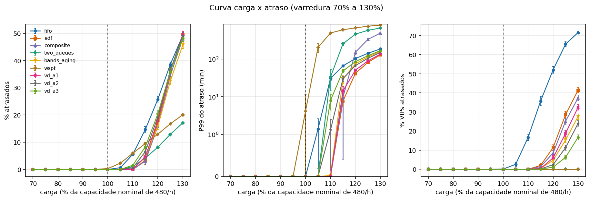

_Atrasos em funcao da carga, uma linha por estrategia._

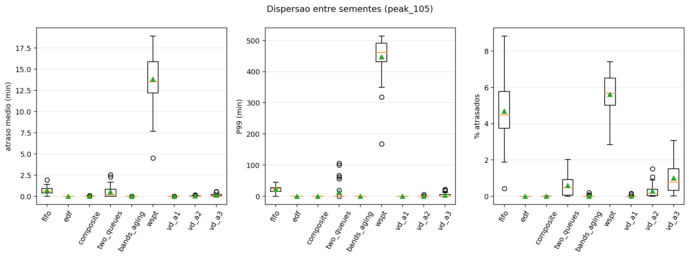

_Distribuicao por semente em peak_105._

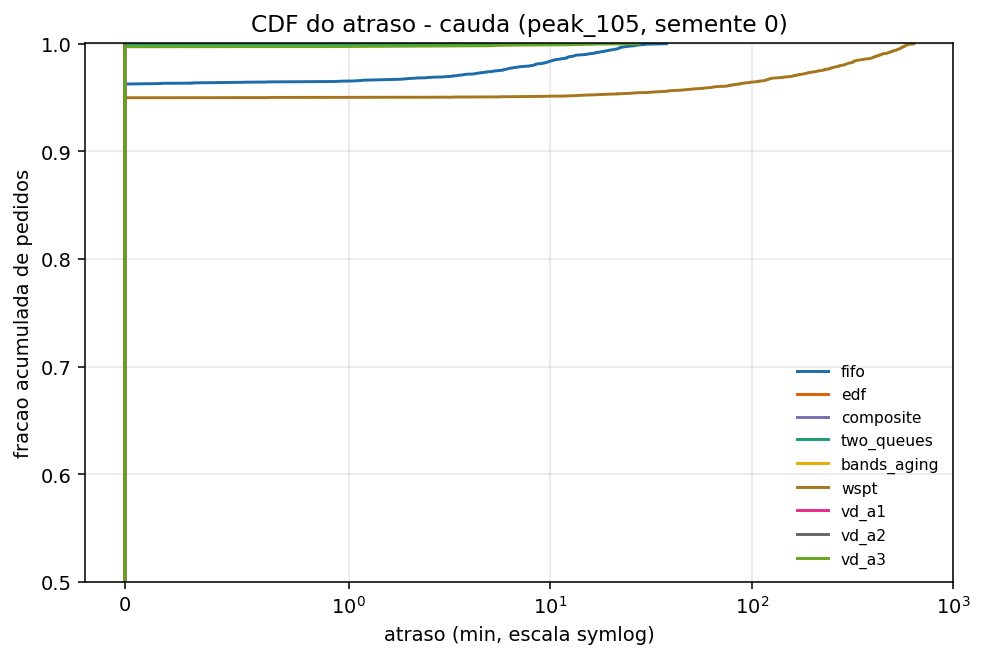

_CDF do atraso na cauda; curvas mais a esquerda sao melhores._

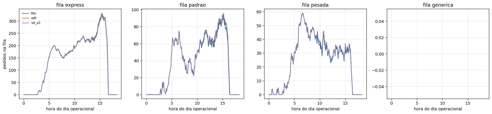

_Tamanho das filas por classe de doca ao longo do dia._

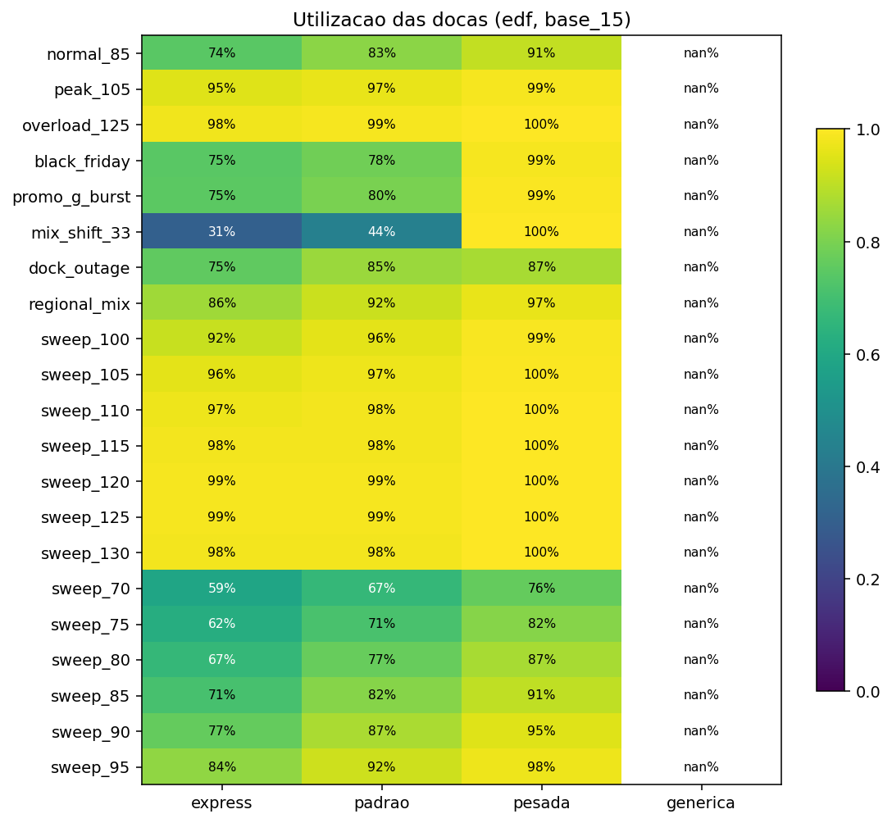

_Utilizacao media por classe de doca e cenario._

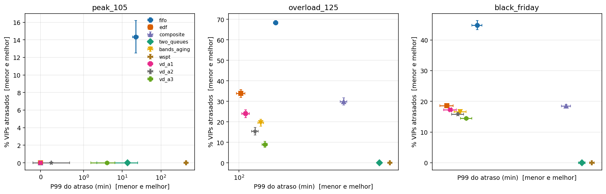

_Compromisso entre protecao de VIP e cauda do atraso._

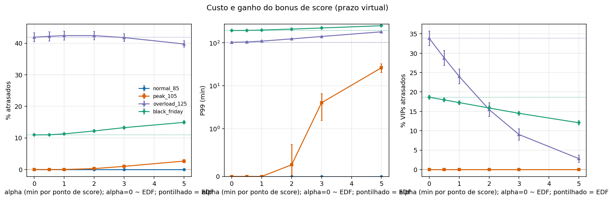

_Efeito de alpha nos atrasos; linhas pontilhadas sao o EDF._

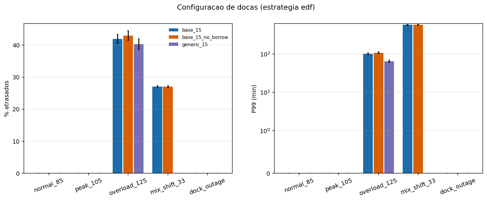

_Docas genericas x especializadas, com e sem emprestimo._

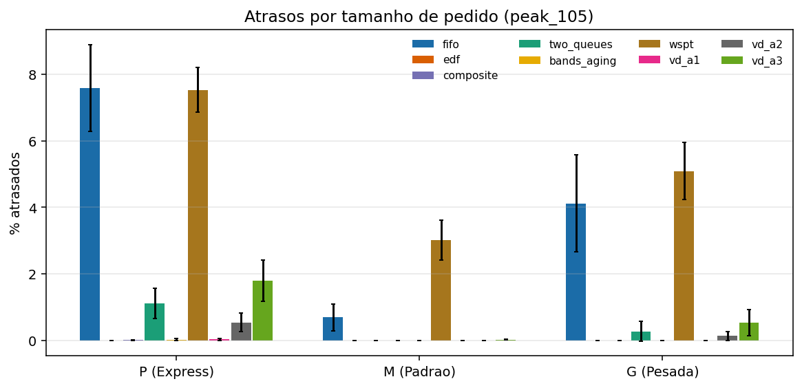

_Quem paga o atraso: P, M ou G._

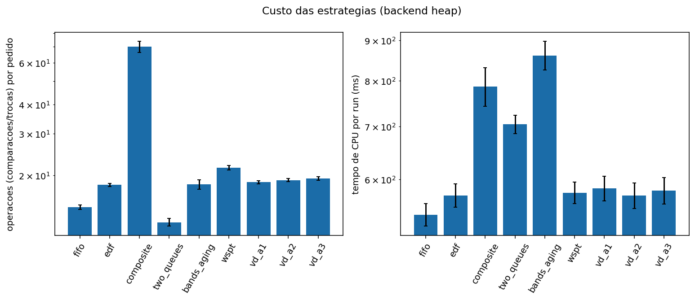

_Custo computacional por estrategia._

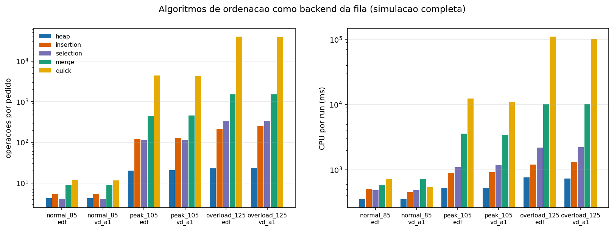

_Custo de manter a fila com cada algoritmo de ordenacao._

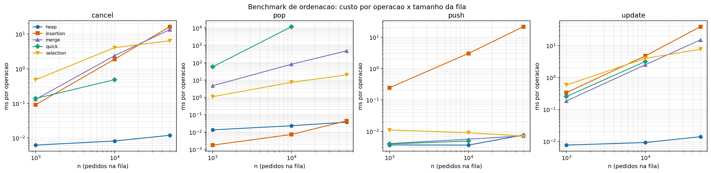

_Crescimento do custo por operacao com n._

## 5. Docas e custo

Configuracoes de docas encontradas: base_15, base_15_no_borrow, generic_15. Ver grafico 09.

EDF em `peak_105`:

| dock_config | pct_late | p99_delay_min | throughput_per_h | emprestimos |
|---|---|---|---|---|
| base_15 | 0.00 | 0.00 | 484.43 | 281.37 |
| base_15_no_borrow | 0.00 | 0.00 | 470.79 | 0.00 |
| generic_15 | 0.00 | 0.00 | 488.14 | 0.00 |

### Algoritmos de ordenacao (backends)

Comparadas 240 execucoes de backends alternativos com o heap: 0 divergem em % de atrasados (esperado: 0, pois a chave e a mesma).

EDF, operacoes por pedido e CPU por run:

| scenario_id | backend | ops_per_order | cpu_ms |
|---|---|---|---|
| normal_85 | heap | 4.2 | 353.8 |
| normal_85 | insertion | 5.3 | 509.7 |
| normal_85 | merge | 9.0 | 577.4 |
| normal_85 | quick | 11.7 | 722.0 |
| normal_85 | selection | 4.0 | 485.2 |
| overload_125 | heap | 23.0 | 763.9 |
| overload_125 | insertion | 215.5 | 1193.2 |
| overload_125 | merge | 1518.7 | 10206.7 |
| overload_125 | quick | 39849.9 | 110507.8 |
| overload_125 | selection | 341.1 | 2197.1 |
| peak_105 | heap | 20.1 | 522.1 |
| peak_105 | insertion | 118.7 | 899.3 |
| peak_105 | merge | 449.0 | 3593.7 |
| peak_105 | quick | 4431.0 | 12404.6 |
| peak_105 | selection | 112.7 | 1091.3 |

## 6. Limitacoes

- Dados sinteticos: o score e gerado a partir de SLA, distancia, valor e reputacao, o que favorece estrategias que usam o score.
- A embalagem e deterministica (P=1, M=2, G=4 min); nao ha variabilidade de transporte nem de mao de obra.
- Parametros dos concorrentes (faixa 30 min, aging 0,2, limite 60 min) nao foram calibrados com o mesmo rigor do alpha.
- Os limites do criterio (50% de reducao de VIP, 1.0 pp, 20% de P99) sao sugestoes do grupo.
