# VelozMart MPS - relatorio de analise

Gerado a partir de `results/v2\runs.csv`. 21540 execucoes; 21 cenarios; 12 estrategias; sementes por cenario: 30.

Configuracao de docas principal: `base_15`. IC = 95% (t de Student) entre sementes; comparacoes entre estrategias usam as mesmas sementes (mesmos pedidos).

## 1. Resposta rapida

**Algoritmo recomendado pelo criterio: EDF.**

- **normal_85:** EDF reduz os atrasados de 0.0% (FIFO) para 0.0% e o P99 de 0.0 para 0.0 min.
  - menor % de atrasados: **edf** (0.0%); menor P99: **fifo** (0.0 min); menos VIPs atrasados: **edf** (0.0%).
- **peak_105:** EDF reduz os atrasados de 20.1% (FIFO) para 14.1% e o P99 de 34.4 para 18.3 min.
  - menor % de atrasados: **two_queues** (9.1%); menor P99: **edf** (18.3 min); menos VIPs atrasados: **two_queues** (0.0%).
- **overload_125:** EDF reduz os atrasados de 73.0% (FIFO) para 74.4% e o P99 de 179.1 para 165.5 min.
  - menor % de atrasados: **wspt** (23.0%); menor P99: **edf** (165.5 min); menos VIPs atrasados: **two_queues** (0.0%).

## 2. Pergunta III: metricas contra a ordenacao simples por tempo (FIFO)

### normal_85

| estrategia | % atrasados | % VIP atrasados | atraso medio (min) | P95 (min) | P99 (min) | pior (min) | pedidos/h |
|---|---|---|---|---|---|---|---|
| fifo | 0.00 ± 0.00 | 0.00 ± 0.01 | 0.00 ± 0.00 | 0.0 ± 0.0 | 0.0 ± 0.0 | 0.1 ± 0.2 | 414.7 ± 2.4 |
| edf | 0.00 ± 0.00 | 0.00 ± 0.00 | 0.00 ± 0.00 | 0.0 ± 0.0 | 0.0 ± 0.0 | 0.0 ± 0.0 | 414.8 ± 2.4 |
| composite | 0.00 ± 0.00 | 0.00 ± 0.00 | 0.00 ± 0.00 | 0.0 ± 0.0 | 0.0 ± 0.0 | 0.0 ± 0.0 | 414.8 ± 2.4 |
| two_queues | 0.04 ± 0.04 | 0.00 ± 0.00 | 0.01 ± 0.01 | 0.0 ± 0.0 | 0.0 ± 0.0 | 12.3 ± 8.9 | 414.8 ± 2.4 |
| bands_aging | 0.00 ± 0.00 | 0.00 ± 0.00 | 0.00 ± 0.00 | 0.0 ± 0.0 | 0.0 ± 0.0 | 0.0 ± 0.0 | 414.8 ± 2.4 |
| wspt | 0.16 ± 0.08 | 0.00 ± 0.00 | 0.04 ± 0.02 | 0.0 ± 0.0 | 0.0 ± 0.0 | 35.4 ± 14.0 | 414.8 ± 2.4 |
| vd_a0 | 0.00 ± 0.00 | 0.00 ± 0.00 | 0.00 ± 0.00 | 0.0 ± 0.0 | 0.0 ± 0.0 | 0.0 ± 0.0 | 414.8 ± 2.4 |
| vd_a0.5 | 0.00 ± 0.00 | 0.00 ± 0.00 | 0.00 ± 0.00 | 0.0 ± 0.0 | 0.0 ± 0.0 | 0.0 ± 0.0 | 414.8 ± 2.4 |
| vd_a1 | 0.00 ± 0.00 | 0.00 ± 0.00 | 0.00 ± 0.00 | 0.0 ± 0.0 | 0.0 ± 0.0 | 0.4 ± 0.8 | 414.8 ± 2.4 |
| vd_a2 | 0.01 ± 0.02 | 0.00 ± 0.00 | 0.00 ± 0.00 | 0.0 ± 0.0 | 0.0 ± 0.0 | 2.8 ± 3.4 | 414.8 ± 2.4 |
| vd_a3 | 0.02 ± 0.02 | 0.00 ± 0.00 | 0.00 ± 0.00 | 0.0 ± 0.0 | 0.0 ± 0.0 | 5.2 ± 4.6 | 414.8 ± 2.4 |
| vd_a5 | 0.05 ± 0.03 | 0.00 ± 0.00 | 0.01 ± 0.01 | 0.0 ± 0.0 | 0.0 ± 0.0 | 12.5 ± 6.9 | 414.8 ± 2.4 |

### peak_105

| estrategia | % atrasados | % VIP atrasados | atraso medio (min) | P95 (min) | P99 (min) | pior (min) | pedidos/h |
|---|---|---|---|---|---|---|---|
| fifo | 20.12 ± 2.72 | 32.37 ± 4.18 | 3.20 ± 0.69 | 21.7 ± 3.8 | 34.4 ± 4.3 | 46.9 ± 4.9 | 484.9 ± 2.6 |
| edf | 14.06 ± 3.17 | 11.04 ± 2.96 | 1.65 ± 0.53 | 11.4 ± 3.4 | 18.3 ± 4.1 | 21.5 ± 4.5 | 484.9 ± 2.5 |
| composite | 12.06 ± 2.68 | 6.93 ± 2.44 | 1.70 ± 0.54 | 2.0 ± 0.8 | 53.3 ± 18.8 | 320.1 ± 81.7 | 485.1 ± 2.5 |
| two_queues | 9.13 ± 0.47 | 0.00 ± 0.00 | 19.39 ± 1.78 | 115.3 ± 18.8 | 527.4 ± 31.8 | 699.6 ± 26.9 | 484.9 ± 2.8 |
| bands_aging | 14.89 ± 1.95 | 0.27 ± 0.37 | 5.45 ± 0.89 | 41.1 ± 6.0 | 80.2 ± 7.5 | 180.5 ± 13.0 | 485.1 ± 2.5 |
| wspt | 9.31 ± 0.42 | 0.00 ± 0.00 | 22.28 ± 1.83 | 148.5 ± 22.2 | 568.5 ± 25.4 | 729.1 ± 10.4 | 484.9 ± 2.7 |
| vd_a0 | 14.06 ± 3.17 | 11.04 ± 2.96 | 1.65 ± 0.53 | 11.4 ± 3.4 | 18.3 ± 4.1 | 21.5 ± 4.5 | 484.9 ± 2.5 |
| vd_a0.5 | 15.47 ± 3.16 | 6.37 ± 2.45 | 1.92 ± 0.55 | 13.1 ± 3.5 | 23.0 ± 4.0 | 35.5 ± 4.4 | 485.0 ± 2.5 |
| vd_a1 | 17.62 ± 2.80 | 3.12 ± 1.58 | 2.63 ± 0.59 | 18.2 ± 3.4 | 32.4 ± 4.1 | 53.9 ± 4.7 | 485.0 ± 2.5 |
| vd_a2 | 20.27 ± 2.24 | 0.88 ± 0.82 | 4.63 ± 0.71 | 31.9 ± 3.9 | 54.3 ± 4.4 | 96.9 ± 5.5 | 484.9 ± 2.5 |
| vd_a3 | 20.87 ± 1.98 | 0.39 ± 0.50 | 6.52 ± 0.83 | 44.9 ± 4.6 | 75.6 ± 5.0 | 138.9 ± 7.9 | 484.9 ± 2.5 |
| vd_a5 | 20.20 ± 1.63 | 0.10 ± 0.19 | 9.45 ± 1.02 | 66.9 ± 5.7 | 113.9 ± 6.0 | 217.7 ± 12.6 | 484.8 ± 2.6 |

### overload_125

| estrategia | % atrasados | % VIP atrasados | atraso medio (min) | P95 (min) | P99 (min) | pior (min) | pedidos/h |
|---|---|---|---|---|---|---|---|
| fifo | 73.04 ± 0.62 | 79.46 ± 0.48 | 57.48 ± 1.94 | 154.6 ± 3.9 | 179.1 ± 4.2 | 197.1 ± 4.3 | 493.9 ± 2.4 |
| edf | 74.38 ± 0.44 | 71.30 ± 0.59 | 56.60 ± 1.97 | 150.1 ± 4.1 | 165.5 ± 4.3 | 169.7 ± 4.4 | 493.9 ± 2.5 |
| composite | 71.94 ± 0.49 | 64.77 ± 0.74 | 56.67 ± 1.96 | 450.0 ± 14.3 | 702.7 ± 6.1 | 820.7 ± 8.6 | 493.9 ± 2.4 |
| two_queues | 23.13 ± 0.31 | 0.00 ± 0.00 | 86.31 ± 1.96 | 627.2 ± 7.2 | 794.2 ± 5.8 | 913.4 ± 7.7 | 494.2 ± 2.2 |
| bands_aging | 63.84 ± 0.84 | 31.62 ± 1.75 | 60.75 ± 1.83 | 180.7 ± 3.4 | 222.1 ± 4.0 | 332.0 ± 10.6 | 493.9 ± 2.4 |
| wspt | 23.01 ± 0.31 | 0.00 ± 0.00 | 87.56 ± 1.91 | 633.7 ± 6.5 | 804.9 ± 5.9 | 936.6 ± 7.6 | 494.1 ± 2.2 |
| vd_a0 | 74.38 ± 0.44 | 71.30 ± 0.59 | 56.60 ± 1.97 | 150.1 ± 4.1 | 165.5 ± 4.3 | 169.7 ± 4.4 | 493.9 ± 2.5 |
| vd_a0.5 | 74.31 ± 0.47 | 67.60 ± 0.82 | 56.78 ± 1.96 | 150.3 ± 4.1 | 167.7 ± 4.2 | 183.6 ± 4.3 | 493.9 ± 2.4 |
| vd_a1 | 73.93 ± 0.55 | 63.04 ± 1.20 | 57.20 ± 1.95 | 151.3 ± 3.9 | 173.9 ± 4.1 | 198.9 ± 4.6 | 493.9 ± 2.4 |
| vd_a2 | 71.63 ± 0.72 | 52.17 ± 1.70 | 58.58 ± 1.90 | 159.4 ± 3.6 | 189.8 ± 4.1 | 238.9 ± 6.9 | 493.9 ± 2.4 |
| vd_a3 | 68.13 ± 0.81 | 40.44 ± 1.90 | 60.37 ± 1.84 | 172.0 ± 3.5 | 209.1 ± 4.2 | 277.2 ± 9.8 | 494.0 ± 2.4 |
| vd_a5 | 60.67 ± 0.83 | 21.00 ± 1.53 | 64.24 ± 1.78 | 202.8 ± 3.3 | 252.5 ± 4.0 | 358.0 ± 10.7 | 494.0 ± 2.3 |

### black_friday

| estrategia | % atrasados | % VIP atrasados | atraso medio (min) | P95 (min) | P99 (min) | pior (min) | pedidos/h |
|---|---|---|---|---|---|---|---|
| fifo | 37.87 ± 1.35 | 60.67 ± 1.08 | 27.92 ± 1.22 | 222.7 ± 8.8 | 269.8 ± 8.7 | 291.6 ± 8.7 | 396.6 ± 3.5 |
| edf | 34.82 ± 1.97 | 43.90 ± 1.54 | 26.03 ± 1.24 | 230.8 ± 9.3 | 257.5 ± 8.6 | 264.2 ± 8.4 | 396.8 ± 3.5 |
| composite | 33.19 ± 1.60 | 40.86 ± 1.40 | 26.07 ± 1.24 | 198.4 ± 17.0 | 574.7 ± 13.3 | 799.0 ± 11.8 | 396.9 ± 3.5 |
| two_queues | 15.38 ± 0.34 | 0.06 ± 0.03 | 46.31 ± 1.39 | 393.9 ± 8.5 | 623.0 ± 10.4 | 853.4 ± 17.0 | 397.1 ± 3.5 |
| bands_aging | 30.73 ± 1.11 | 18.67 ± 0.55 | 30.60 ± 1.21 | 217.8 ± 8.6 | 299.0 ± 8.7 | 429.8 ± 21.3 | 397.3 ± 3.5 |
| wspt | 15.57 ± 0.34 | 0.05 ± 0.03 | 48.11 ± 1.38 | 406.3 ± 8.2 | 630.0 ± 9.2 | 877.8 ± 22.1 | 397.3 ± 3.5 |
| vd_a0 | 34.82 ± 1.97 | 43.90 ± 1.54 | 26.03 ± 1.24 | 230.8 ± 9.3 | 257.5 ± 8.6 | 264.2 ± 8.4 | 396.8 ± 3.5 |
| vd_a0.5 | 35.38 ± 1.73 | 36.89 ± 1.65 | 26.34 ± 1.23 | 229.3 ± 9.3 | 258.8 ± 8.7 | 276.0 ± 8.8 | 396.9 ± 3.5 |
| vd_a1 | 36.22 ± 1.52 | 32.03 ± 1.94 | 27.09 ± 1.22 | 226.4 ± 9.0 | 263.3 ± 8.7 | 293.8 ± 9.0 | 397.1 ± 3.5 |
| vd_a2 | 36.17 ± 1.29 | 25.06 ± 1.52 | 29.11 ± 1.20 | 220.8 ± 8.9 | 276.5 ± 8.8 | 332.1 ± 9.5 | 397.2 ± 3.5 |
| vd_a3 | 34.97 ± 1.11 | 20.47 ± 0.74 | 31.06 ± 1.21 | 217.5 ± 8.8 | 290.8 ± 8.7 | 376.2 ± 11.7 | 397.4 ± 3.5 |
| vd_a5 | 32.11 ± 0.87 | 16.28 ± 0.51 | 34.15 ± 1.22 | 218.2 ± 8.4 | 322.2 ± 8.8 | 462.1 ± 18.0 | 397.7 ± 3.5 |

### dock_outage

| estrategia | % atrasados | % VIP atrasados | atraso medio (min) | P95 (min) | P99 (min) | pior (min) | pedidos/h |
|---|---|---|---|---|---|---|---|
| fifo | 0.89 ± 0.38 | 3.45 ± 1.34 | 0.09 ± 0.06 | 0.0 ± 0.0 | 3.0 ± 2.1 | 15.9 ± 5.0 | 415.7 ± 1.8 |
| edf | 0.25 ± 0.27 | 0.50 ± 0.57 | 0.01 ± 0.02 | 0.0 ± 0.0 | 0.5 ± 1.0 | 2.1 ± 1.9 | 415.8 ± 1.8 |
| composite | 0.27 ± 0.28 | 0.41 ± 0.52 | 0.02 ± 0.02 | 0.0 ± 0.0 | 0.3 ± 0.4 | 7.1 ± 8.8 | 415.7 ± 1.8 |
| two_queues | 0.62 ± 0.13 | 0.00 ± 0.00 | 0.75 ± 0.26 | 0.0 ± 0.0 | 4.7 ± 8.2 | 252.4 ± 46.0 | 415.9 ± 1.8 |
| bands_aging | 0.53 ± 0.25 | 0.02 ± 0.03 | 0.16 ± 0.09 | 0.0 ± 0.0 | 3.2 ± 3.8 | 53.9 ± 17.6 | 415.8 ± 1.8 |
| wspt | 0.75 ± 0.14 | 0.00 ± 0.00 | 0.97 ± 0.29 | 0.0 ± 0.0 | 8.6 ± 9.8 | 318.5 ± 48.4 | 415.9 ± 1.8 |
| vd_a0 | 0.25 ± 0.27 | 0.50 ± 0.57 | 0.01 ± 0.02 | 0.0 ± 0.0 | 0.5 ± 1.0 | 2.1 ± 1.9 | 415.8 ± 1.8 |
| vd_a0.5 | 0.39 ± 0.29 | 0.20 ± 0.35 | 0.03 ± 0.03 | 0.0 ± 0.0 | 0.8 ± 1.1 | 8.2 ± 3.4 | 415.8 ± 1.8 |
| vd_a1 | 0.60 ± 0.31 | 0.13 ± 0.25 | 0.06 ± 0.04 | 0.0 ± 0.0 | 1.5 ± 1.7 | 17.6 ± 5.0 | 415.8 ± 1.8 |
| vd_a2 | 0.86 ± 0.32 | 0.06 ± 0.11 | 0.16 ± 0.07 | 0.0 ± 0.0 | 3.9 ± 3.0 | 41.6 ± 8.4 | 415.8 ± 1.8 |
| vd_a3 | 0.94 ± 0.30 | 0.03 ± 0.06 | 0.25 ± 0.10 | 0.0 ± 0.0 | 6.5 ± 4.3 | 66.1 ± 10.9 | 415.8 ± 1.8 |
| vd_a5 | 0.98 ± 0.27 | 0.00 ± 0.00 | 0.40 ± 0.14 | 0.0 ± 0.0 | 10.0 ± 6.1 | 105.6 ± 15.0 | 415.8 ± 1.8 |

## 3. Criterio de decisao: EDF x prazo virtual

Criterio (secao 5.3): o prazo virtual so substitui o EDF se, em **todos** os cenarios decisivos (peak_105, overload_125, black_friday), reduzir os VIPs atrasados em pelo menos 50% (partindo de pelo menos 1.0% de VIP atrasado no EDF) sem piorar a % de atrasados em mais de 1.0 pp nem o P99 em mais de 20%; diferencas dentro do IC 95% pareado por semente contam como empate; nos cenarios de guarda (normal_85) nao pode regredir.

| estrategia | cenario | papel | VIP EDF % | VIP estrat. % | reducao VIP | delta % atrasados (pp) | IC | delta P99 (%) | passa |
|---|---|---|---|---|---|---|---|---|---|
| vd_a0.5 | peak_105 | decisivo | 11.04 | 6.37 | 42.32 | 1.42 | 0.50 | 25.61 | nao |
| vd_a0.5 | overload_125 | decisivo | 71.30 | 67.60 | 5.19 | -0.07 | 0.11 | 1.38 | nao |
| vd_a0.5 | black_friday | decisivo | 43.90 | 36.89 | 15.97 | 0.57 | 0.56 | 0.47 | nao |
| vd_a0.5 | normal_85 | guarda | 0.00 | 0.00 |  | 0.00 | 0.00 | 0.00 | sim |
| vd_a1 | peak_105 | decisivo | 11.04 | 3.12 | 71.73 | 3.56 | 0.90 | 77.38 | nao |
| vd_a1 | overload_125 | decisivo | 71.30 | 63.04 | 11.59 | -0.46 | 0.20 | 5.10 | nao |
| vd_a1 | black_friday | decisivo | 43.90 | 32.03 | 27.04 | 1.40 | 0.91 | 2.25 | nao |
| vd_a1 | normal_85 | guarda | 0.00 | 0.00 |  | 0.00 | 0.00 | 0.00 | sim |
| vd_a2 | peak_105 | decisivo | 11.04 | 0.88 | 92.05 | 6.22 | 1.44 | 196.85 | nao |
| vd_a2 | overload_125 | decisivo | 71.30 | 52.17 | 26.84 | -2.76 | 0.36 | 14.74 | nao |
| vd_a2 | black_friday | decisivo | 43.90 | 25.06 | 42.91 | 1.35 | 1.12 | 7.36 | nao |
| vd_a2 | normal_85 | guarda | 0.00 | 0.00 |  | 0.01 | 0.02 | 0.00 | sim |
| vd_a3 | peak_105 | decisivo | 11.04 | 0.39 | 96.44 | 6.81 | 1.72 | 313.30 | nao |
| vd_a3 | overload_125 | decisivo | 71.30 | 40.44 | 43.28 | -6.26 | 0.48 | 26.38 | nao |
| vd_a3 | black_friday | decisivo | 43.90 | 20.47 | 53.38 | 0.15 | 1.21 | 12.92 | sim |
| vd_a3 | normal_85 | guarda | 0.00 | 0.00 |  | 0.02 | 0.02 | 0.00 | sim |
| vd_a5 | peak_105 | decisivo | 11.04 | 0.10 | 99.10 | 6.15 | 2.00 | 523.16 | nao |
| vd_a5 | overload_125 | decisivo | 71.30 | 21.00 | 70.55 | -13.72 | 0.53 | 52.63 | nao |
| vd_a5 | black_friday | decisivo | 43.90 | 16.28 | 62.92 | -2.71 | 1.34 | 25.11 | nao |
| vd_a5 | normal_85 | guarda | 0.00 | 0.00 |  | 0.05 | 0.03 | 0.00 | sim |

**Veredito:** **EDF**: nenhum prazo virtual testado atende ao criterio (ou os resultados empatam, e o empate vai para o EDF pela simplicidade).

### Veredito por configuracao de docas

- `base_15_no_borrow`: EDF
- `generic_15`: EDF
- `generic_nested_15`: EDF
- `generic_speed_15`: EDF

### Calibracao de alpha

Calibracao em sementes separadas (`calibration_runs.csv`, docas `base_15`): os mesmos limites do criterio aplicados as medias das sementes de calibracao.

| alpha | cenario | reducao VIP (%) | delta % atrasados (pp) | delta P99 (%) | atende |
|---|---|---|---|---|---|
| vd_a0.5 | peak_105 | 59.35 | 1.05 | 27.09 | nao |
| vd_a0.5 | overload_125 | 5.10 | -0.05 | 1.62 | nao |
| vd_a0.5 | black_friday | 11.85 | 0.98 | 0.34 | nao |
| vd_a1 | peak_105 | 88.49 | 2.81 | 84.83 | nao |
| vd_a1 | overload_125 | 11.53 | -0.42 | 5.22 | nao |
| vd_a1 | black_friday | 23.59 | 1.76 | 1.88 | nao |
| vd_a2 | peak_105 | 97.21 | 4.91 | 219.55 | nao |
| vd_a2 | overload_125 | 26.59 | -2.69 | 14.96 | nao |
| vd_a2 | black_friday | 42.15 | 1.06 | 6.66 | nao |
| vd_a3 | peak_105 | 99.31 | 5.19 | 345.83 | nao |
| vd_a3 | overload_125 | 41.40 | -6.09 | 26.38 | nao |
| vd_a3 | black_friday | 52.83 | -0.46 | 12.19 | sim |
| vd_a5 | peak_105 | 100.00 | 4.38 | 567.13 | nao |
| vd_a5 | overload_125 | 66.68 | -13.36 | 52.32 | nao |
| vd_a5 | black_friday | 62.26 | -3.36 | 24.62 | nao |

**Nenhum alpha da grade atende aos limites na calibracao**; a decisao fica com o EDF.

### Comparacao de configuracoes de docas

Docas: `base_15` = especializada (emprestimo); `base_15_no_borrow` = especializada (sem emprestimo); `generic_15` = generica uniforme; `generic_nested_15` = generica tamanhos variados (capacidade); `generic_speed_15` = generica tamanhos variados (velocidade).

**edf - % atrasados**

| cenario | base_15 | base_15_no_borrow | generic_15 | generic_nested_15 | generic_speed_15 |
|---|---|---|---|---|---|
| normal_85 | 0.0 | 0.0 | 0.0 | 0.0 | 0.0 |
| peak_105 | 14.1 | 17.7 | 1.6 | 2.7 | 1.7 |
| overload_125 | 74.4 | 74.8 | 73.9 | 73.6 | 73.9 |
| black_friday | 34.8 | 37.2 | 59.9 | 36.1 | 59.9 |
| promo_g_burst | 11.7 | 11.7 | 0.0 | 12.6 | 0.0 |
| mix_shift_33 | 29.7 | 29.7 | 30.5 | 27.9 | 30.5 |
| dock_outage | 0.3 | 0.2 | 0.0 | 0.0 | 0.0 |
| regional_mix | 0.1 | 0.1 | 0.0 | 0.0 | 0.0 |

**edf - P99 (min)**

| cenario | base_15 | base_15_no_borrow | generic_15 | generic_nested_15 | generic_speed_15 |
|---|---|---|---|---|---|
| normal_85 | 0 | 0 | 0 | 0 | 0 |
| peak_105 | 18 | 23 | 1 | 2 | 1 |
| overload_125 | 165 | 176 | 134 | 137 | 134 |
| black_friday | 258 | 257 | 100 | 154 | 100 |
| promo_g_burst | 129 | 128 | 0 | 72 | 0 |
| mix_shift_33 | 656 | 656 | 21 | 393 | 21 |
| dock_outage | 1 | 1 | 0 | 0 | 0 |
| regional_mix | 0 | 0 | 0 | 0 | 0 |

**edf - % VIPs atrasados**

| cenario | base_15 | base_15_no_borrow | generic_15 | generic_nested_15 | generic_speed_15 |
|---|---|---|---|---|---|
| normal_85 | 0.0 | 0.0 | 0.0 | 0.0 | 0.0 |
| peak_105 | 11.0 | 12.7 | 1.6 | 3.4 | 1.7 |
| overload_125 | 71.3 | 71.6 | 71.2 | 71.7 | 71.2 |
| black_friday | 43.9 | 45.3 | 58.1 | 47.7 | 58.1 |
| promo_g_burst | 21.0 | 20.9 | 0.0 | 20.8 | 0.0 |
| mix_shift_33 | 46.6 | 46.6 | 29.5 | 43.5 | 29.5 |
| dock_outage | 0.5 | 0.5 | 0.0 | 0.0 | 0.0 |
| regional_mix | 0.3 | 0.3 | 0.0 | 0.0 | 0.0 |

**edf - pedidos/h**

| cenario | base_15 | base_15_no_borrow | generic_15 | generic_nested_15 | generic_speed_15 |
|---|---|---|---|---|---|
| normal_85 | 415 | 415 | 415 | 415 | 415 |
| peak_105 | 485 | 472 | 488 | 487 | 488 |
| overload_125 | 494 | 477 | 496 | 494 | 496 |
| black_friday | 397 | 397 | 458 | 442 | 458 |
| promo_g_burst | 409 | 409 | 469 | 453 | 469 |
| mix_shift_33 | 228 | 228 | 380 | 274 | 380 |
| dock_outage | 416 | 416 | 416 | 416 | 416 |
| regional_mix | 459 | 458 | 461 | 458 | 461 |

**vd_a2 - % atrasados**

| cenario | base_15 | base_15_no_borrow | generic_15 | generic_nested_15 | generic_speed_15 |
|---|---|---|---|---|---|
| normal_85 | 0.0 | 0.0 | 0.0 | 0.0 | 0.0 |
| peak_105 | 20.3 | 22.8 | 17.8 | 14.6 | 17.8 |
| overload_125 | 71.6 | 72.1 | 73.0 | 70.1 | 72.9 |
| black_friday | 36.2 | 37.4 | 60.2 | 38.9 | 60.2 |
| promo_g_burst | 11.5 | 11.6 | 9.3 | 15.7 | 9.3 |
| mix_shift_33 | 29.4 | 29.4 | 39.2 | 27.8 | 39.2 |
| dock_outage | 0.9 | 0.8 | 0.0 | 0.2 | 0.0 |
| regional_mix | 0.3 | 0.6 | 0.1 | 0.5 | 0.1 |

**vd_a2 - P99 (min)**

| cenario | base_15 | base_15_no_borrow | generic_15 | generic_nested_15 | generic_speed_15 |
|---|---|---|---|---|---|
| normal_85 | 0 | 0 | 0 | 0 | 0 |
| peak_105 | 54 | 59 | 40 | 42 | 40 |
| overload_125 | 190 | 199 | 172 | 172 | 172 |
| black_friday | 276 | 276 | 149 | 182 | 149 |
| promo_g_burst | 155 | 154 | 27 | 92 | 27 |
| mix_shift_33 | 664 | 664 | 70 | 407 | 70 |
| dock_outage | 4 | 4 | 0 | 0 | 0 |
| regional_mix | 1 | 2 | 0 | 1 | 0 |

**vd_a2 - % VIPs atrasados**

| cenario | base_15 | base_15_no_borrow | generic_15 | generic_nested_15 | generic_speed_15 |
|---|---|---|---|---|---|
| normal_85 | 0.0 | 0.0 | 0.0 | 0.0 | 0.0 |
| peak_105 | 0.9 | 0.9 | 0.0 | 0.0 | 0.0 |
| overload_125 | 52.2 | 52.6 | 53.0 | 53.6 | 53.0 |
| black_friday | 25.1 | 25.2 | 43.1 | 38.0 | 43.1 |
| promo_g_burst | 18.0 | 18.0 | 0.0 | 12.2 | 0.0 |
| mix_shift_33 | 43.3 | 43.3 | 2.7 | 39.7 | 2.7 |
| dock_outage | 0.1 | 0.1 | 0.0 | 0.0 | 0.0 |
| regional_mix | 0.0 | 0.0 | 0.0 | 0.0 | 0.0 |

**vd_a2 - pedidos/h**

| cenario | base_15 | base_15_no_borrow | generic_15 | generic_nested_15 | generic_speed_15 |
|---|---|---|---|---|---|
| normal_85 | 415 | 415 | 415 | 415 | 415 |
| peak_105 | 485 | 471 | 488 | 485 | 488 |
| overload_125 | 494 | 477 | 496 | 495 | 496 |
| black_friday | 397 | 397 | 458 | 442 | 458 |
| promo_g_burst | 409 | 409 | 469 | 451 | 469 |
| mix_shift_33 | 228 | 228 | 380 | 273 | 380 |
| dock_outage | 416 | 416 | 416 | 416 | 416 |
| regional_mix | 458 | 458 | 461 | 457 | 461 |

**fifo - % atrasados**

| cenario | base_15 | base_15_no_borrow | generic_15 | generic_nested_15 | generic_speed_15 |
|---|---|---|---|---|---|
| normal_85 | 0.0 | 0.0 | 0.0 | 0.0 | 0.0 |
| peak_105 | 20.1 | 22.9 | 12.6 | 12.2 | 12.6 |
| overload_125 | 73.0 | 73.5 | 72.5 | 72.3 | 72.5 |
| black_friday | 37.9 | 39.3 | 59.9 | 43.1 | 59.9 |
| promo_g_burst | 11.7 | 11.7 | 5.2 | 12.4 | 5.2 |
| mix_shift_33 | 29.7 | 29.7 | 37.8 | 27.7 | 37.7 |
| dock_outage | 0.9 | 0.9 | 0.0 | 0.0 | 0.0 |
| regional_mix | 0.2 | 0.3 | 0.0 | 0.0 | 0.0 |

**fifo - P99 (min)**

| cenario | base_15 | base_15_no_borrow | generic_15 | generic_nested_15 | generic_speed_15 |
|---|---|---|---|---|---|
| normal_85 | 0 | 0 | 0 | 0 | 0 |
| peak_105 | 34 | 41 | 14 | 14 | 14 |
| overload_125 | 179 | 192 | 155 | 155 | 155 |
| black_friday | 270 | 269 | 122 | 159 | 122 |
| promo_g_burst | 144 | 144 | 6 | 78 | 6 |
| mix_shift_33 | 663 | 663 | 42 | 399 | 42 |
| dock_outage | 3 | 3 | 0 | 0 | 0 |
| regional_mix | 1 | 1 | 0 | 0 | 0 |

**fifo - % VIPs atrasados**

| cenario | base_15 | base_15_no_borrow | generic_15 | generic_nested_15 | generic_speed_15 |
|---|---|---|---|---|---|
| normal_85 | 0.0 | 0.0 | 0.0 | 0.0 | 0.0 |
| peak_105 | 32.4 | 33.9 | 32.3 | 33.1 | 32.3 |
| overload_125 | 79.5 | 79.7 | 79.3 | 79.4 | 79.3 |
| black_friday | 60.7 | 61.6 | 67.2 | 62.8 | 67.2 |
| promo_g_burst | 23.1 | 23.1 | 15.4 | 29.1 | 15.4 |
| mix_shift_33 | 48.7 | 48.7 | 65.0 | 46.0 | 65.0 |
| dock_outage | 3.4 | 3.3 | 0.0 | 0.0 | 0.0 |
| regional_mix | 1.0 | 1.0 | 0.0 | 0.0 | 0.0 |

**fifo - pedidos/h**

| cenario | base_15 | base_15_no_borrow | generic_15 | generic_nested_15 | generic_speed_15 |
|---|---|---|---|---|---|
| normal_85 | 415 | 415 | 415 | 415 | 415 |
| peak_105 | 485 | 471 | 488 | 487 | 488 |
| overload_125 | 494 | 477 | 496 | 495 | 496 |
| black_friday | 397 | 397 | 458 | 444 | 458 |
| promo_g_burst | 409 | 409 | 469 | 456 | 469 |
| mix_shift_33 | 228 | 228 | 380 | 275 | 380 |
| dock_outage | 416 | 416 | 416 | 416 | 416 |
| regional_mix | 458 | 458 | 461 | 461 | 461 |

## 4. Graficos

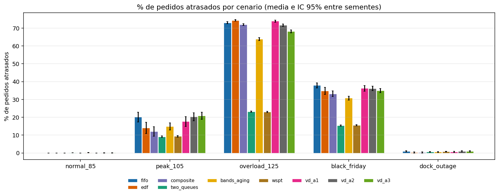

_% de pedidos atrasados por cenario e estrategia._

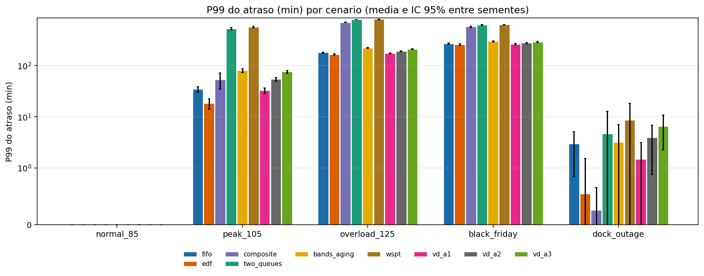

_P99 do atraso (min) por cenario e estrategia._

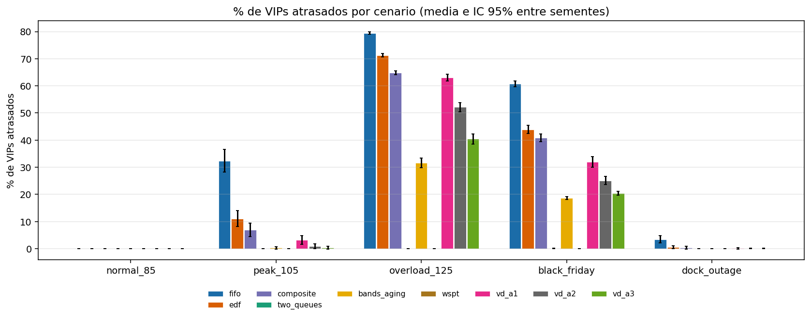

_% de VIPs atrasados por cenario e estrategia._

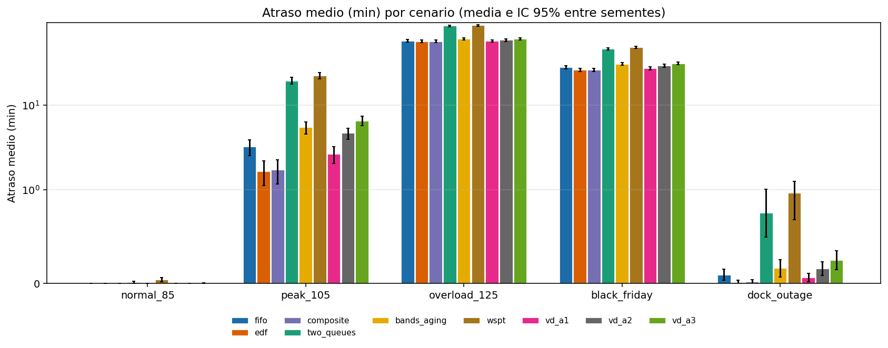

_Atraso medio (min) por cenario e estrategia._

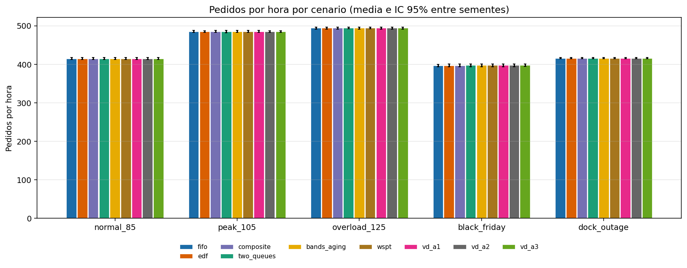

_Pedidos por hora por cenario e estrategia._

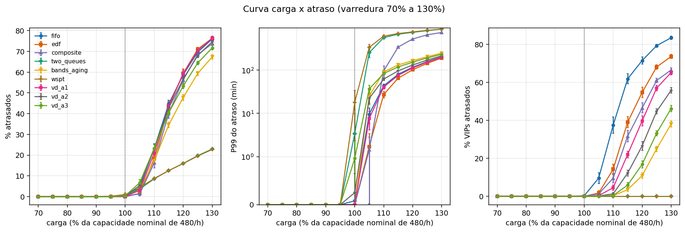

_Atrasos em funcao da carga, uma linha por estrategia._

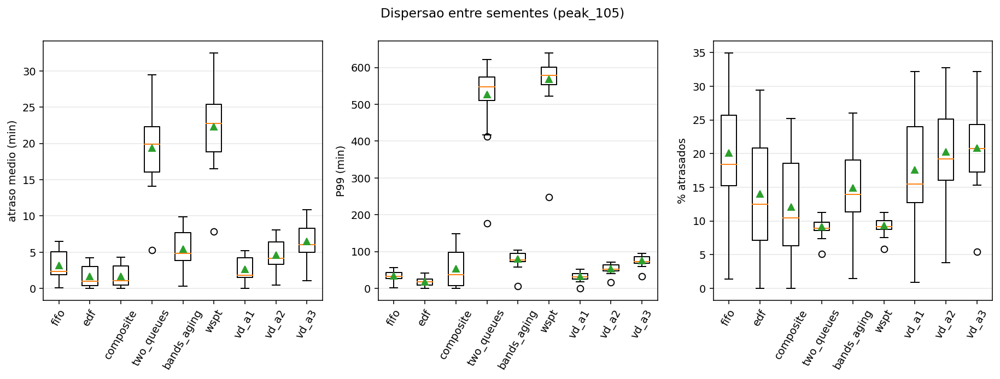

_Distribuicao por semente em peak_105._

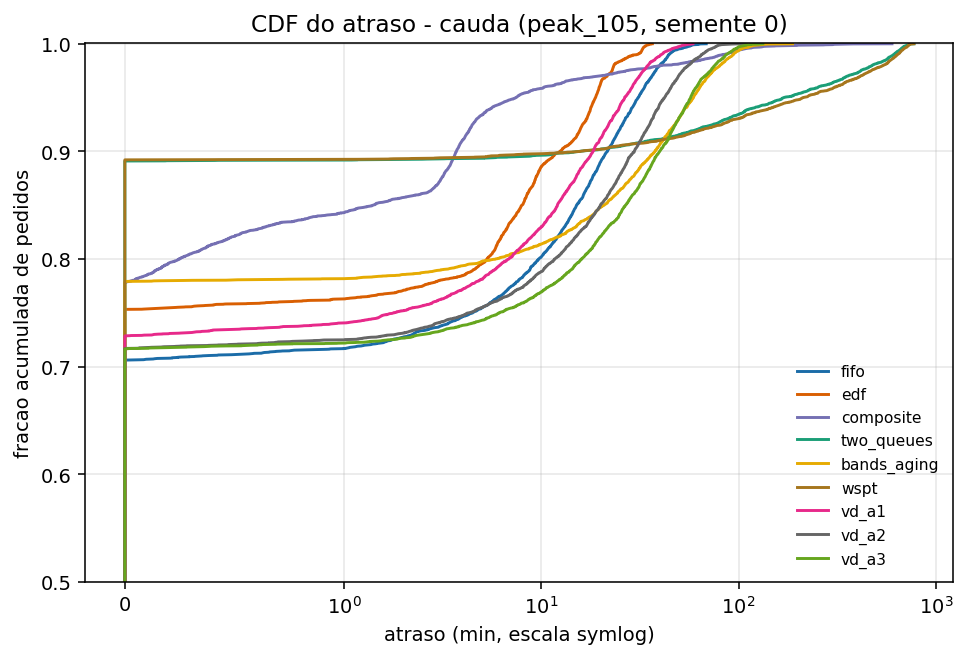

_CDF do atraso na cauda; curvas mais a esquerda sao melhores._

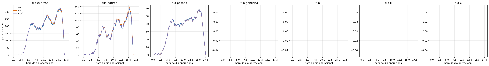

_Tamanho das filas por classe de doca ao longo do dia._

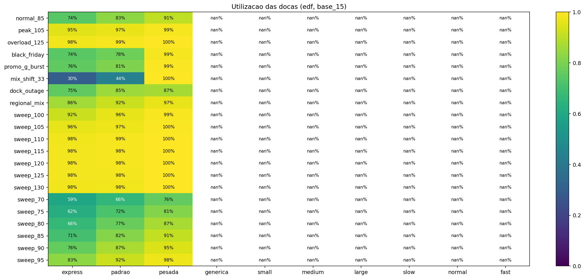

_Utilizacao media por classe de doca e cenario._

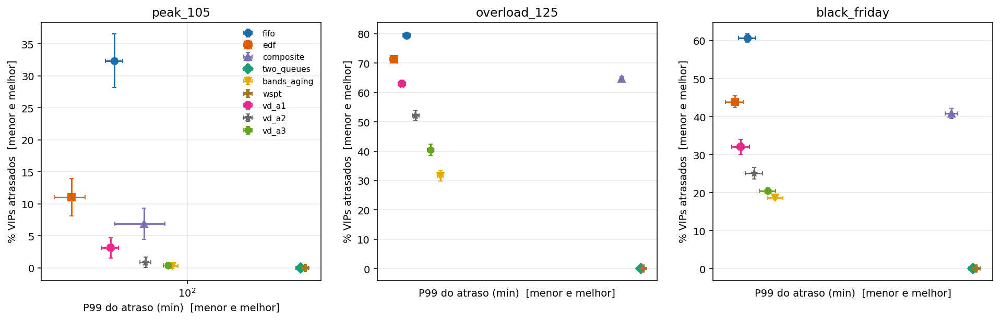

_Compromisso entre protecao de VIP e cauda do atraso._

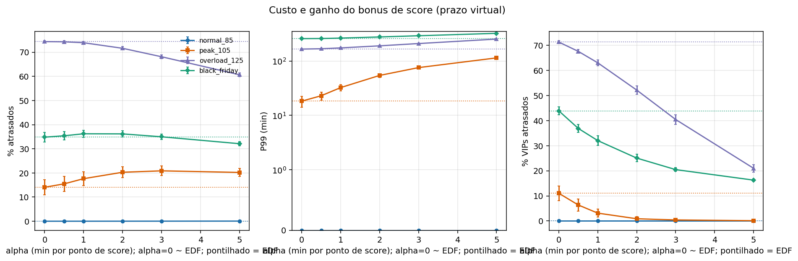

_Efeito de alpha nos atrasos; linhas pontilhadas sao o EDF._

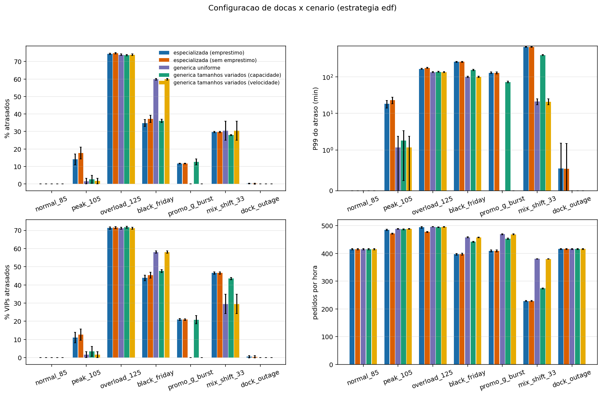

_Docas especializadas x genericas (uniformes e de tamanhos variados)._

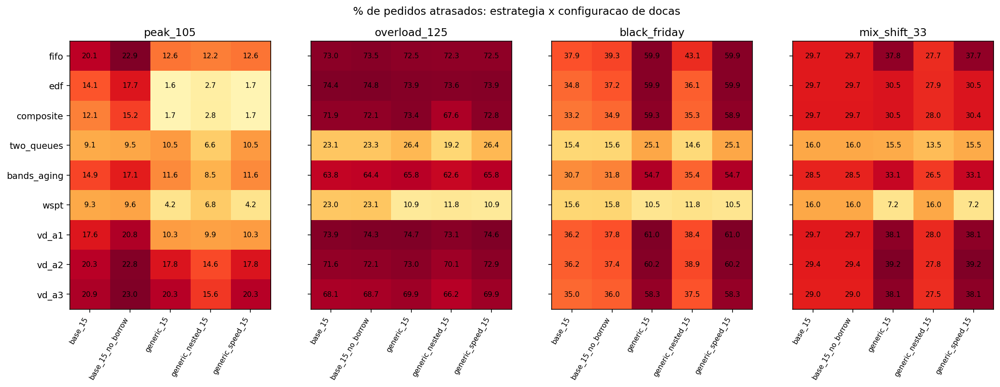

_Qual combinacao estrategia x doca atrasa menos._

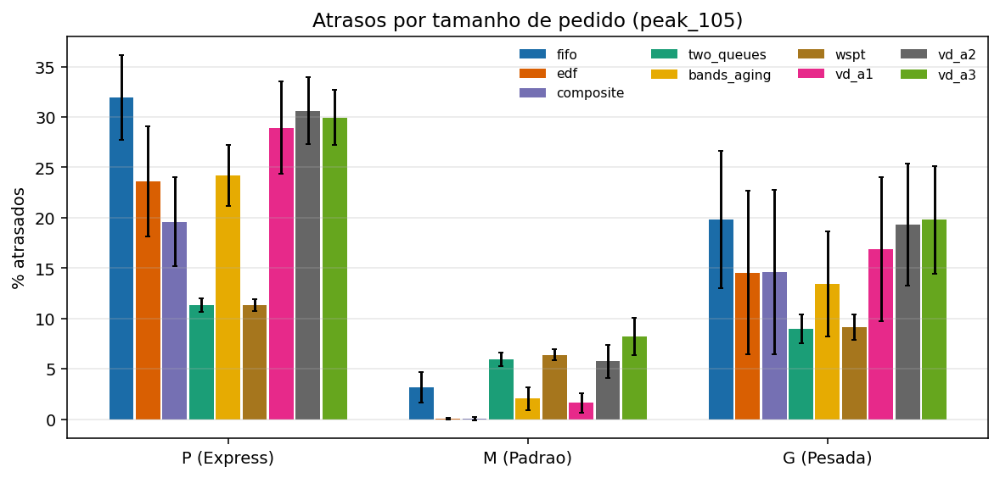

_Quem paga o atraso: P, M ou G._

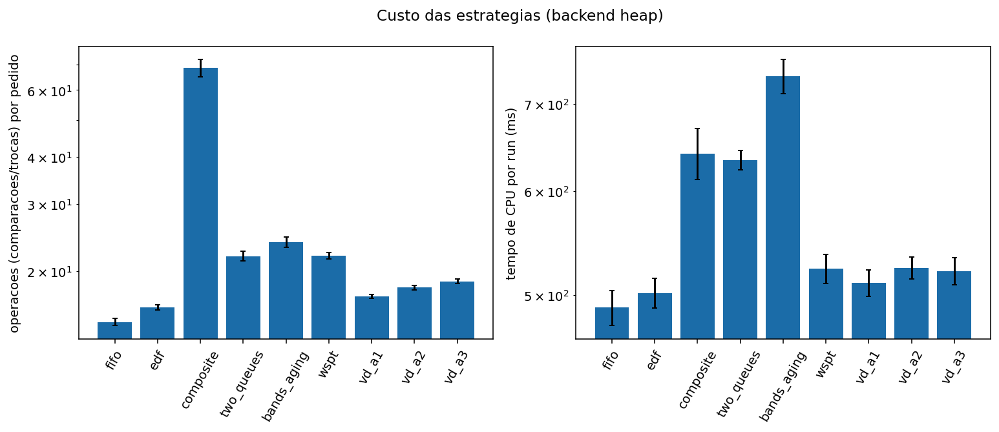

_Custo computacional por estrategia._

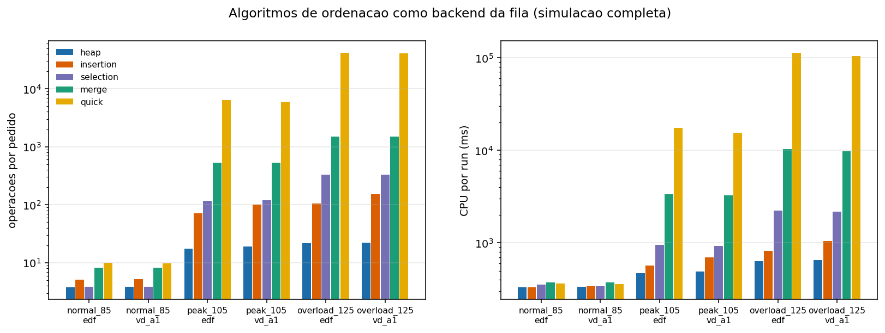

_Custo de manter a fila com cada algoritmo de ordenacao._

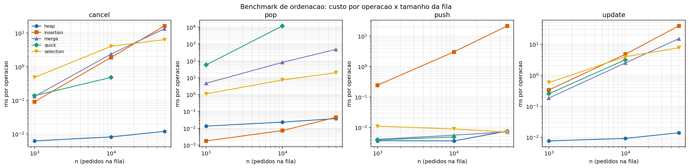

_Crescimento do custo por operacao com n._

## 5. Docas e custo

Configuracoes de docas encontradas: base_15, base_15_no_borrow, generic_15, generic_nested_15, generic_speed_15. Ver grafico 09.

EDF em `peak_105`:

| dock_config | pct_late | p99_delay_min | throughput_per_h | emprestimos |
|---|---|---|---|---|
| base_15 | 14.06 | 18.28 | 484.93 | 272.67 |
| base_15_no_borrow | 17.73 | 23.10 | 471.54 | 0.00 |
| generic_15 | 1.64 | 1.18 | 488.46 | 0.00 |
| generic_nested_15 | 2.69 | 1.80 | 486.80 | 780.53 |
| generic_speed_15 | 1.67 | 1.19 | 488.15 | 0.00 |

### Algoritmos de ordenacao (backends)

Comparadas 120 execucoes de backends alternativos com o heap: 0 divergem em % de atrasados (esperado: 0, pois a chave e a mesma).

EDF, operacoes por pedido e CPU por run:

| scenario_id | backend | ops_per_order | cpu_ms |
|---|---|---|---|
| normal_85 | heap | 3.8 | 331.1 |
| normal_85 | insertion | 5.1 | 332.4 |
| normal_85 | merge | 8.2 | 374.3 |
| normal_85 | quick | 10.1 | 365.0 |
| normal_85 | selection | 3.9 | 353.7 |
| overload_125 | heap | 22.0 | 637.5 |
| overload_125 | insertion | 104.9 | 825.0 |
| overload_125 | merge | 1502.7 | 10340.6 |
| overload_125 | quick | 41784.5 | 113311.2 |
| overload_125 | selection | 330.1 | 2234.7 |
| peak_105 | heap | 17.5 | 471.8 |
| peak_105 | insertion | 71.8 | 571.9 |
| peak_105 | merge | 527.8 | 3346.9 |
| peak_105 | quick | 6379.7 | 17477.8 |
| peak_105 | selection | 118.3 | 956.3 |

## 6. Limitacoes

- Dados sinteticos: o score e gerado a partir de SLA, distancia, valor e reputacao, o que favorece estrategias que usam o score.
- A embalagem e deterministica (P=1, M=2, G=4 min); nao ha variabilidade de transporte nem de mao de obra.
- Parametros dos concorrentes (faixa 30 min, aging 0,2, limite 60 min) nao foram calibrados com o mesmo rigor do alpha.
- Os limites do criterio (50% de reducao de VIP, 1.0 pp, 20% de P99) sao sugestoes do grupo.
